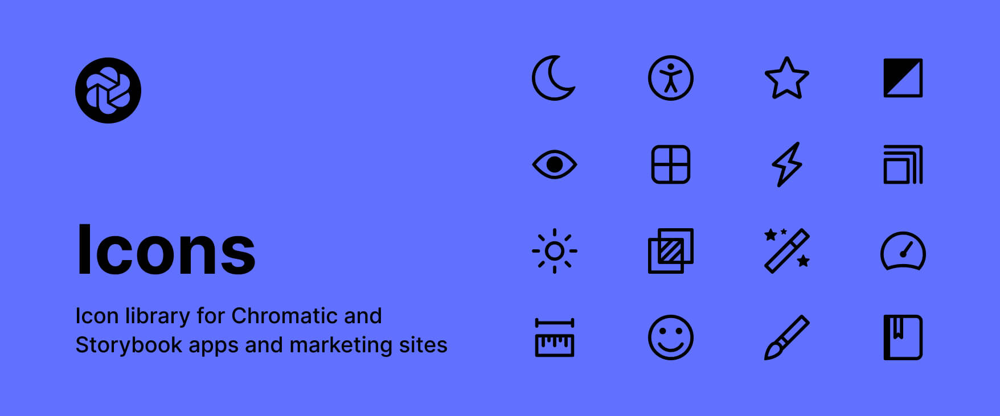

# Icons



This library contains the icons used in Storybook and Chromatic apps and marketing sites. They are 14x14. To view the list of all available icons, please go to https://main--64b56e737c0aeefed9d5e675.chromatic.com/

## Install

npm:

```console
npm install @storybook/icons
```

yarn:

```console
yarn add @storybook/icons
```

pnpm:

```console
pnpm add @storybook/icons
```

## To Do

- [x] Export every single icon instead of a single component
- [x] Add stories for each component

## Generating new icons from Figma

First, set local environment variables:

```console
FIGMA_API_TOKEN=<YOUR_FIGMA_API_TOKEN>
FIGMA_FILE_ID=<FIGMA_FILE_ID>
FIGMA_CANVAS=Icons
```

Then, fetch all icons from Figma locally and create React components + stories automatically:

```console
pnpm generate-icons
```

Inspired by [this article](https://blog.certa.dev/generating-react-icon-components-from-figma).

## Adding an icon with an agent

The repo ships a Claude Code skill, `.claude/skills/storybook-icon/`, that draws an icon in this set's style and wires it in (component, story, export, list entry, changeset). Ask Claude Code for the icon by its meaning and where it will be used, for example "add an icon for a flaky test, for the sidebar status column"; the skill confirms the meaning and the shape with you before drawing, then renders the icon beside its siblings and runs `scripts/add.mjs`. An icon added this way is not in Figma: add it to the Icons canvas under the same name before the next `pnpm generate-icons`, or that run drops it from `src/index.ts` and `src/iconList.tsx`.

## Developing

Watch and rebuild code with `tsup` and run Storybook to preview your UI during development:

```console
pnpm storybook
```

## Building

Build package with `tsup` for production:

```console
pnpm build
```
